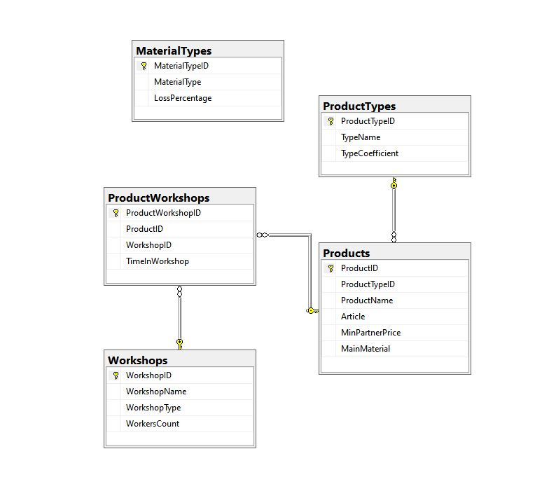

# Comfort — подсистема управления продукцией и цехами

> Десктопное приложение на **C# / WinForms** с базой данных **MS SQL Server** (ADO.NET).
> Решение задания демонстрационного экзамена 2025 (компетенция 09.02.07).
> Автор: Бугаев Евгений Валерьевич.

## Возможности
- Модуль управления **продукцией**: список в виде плиток, добавление и редактирование.
- Модуль управления **цехами**: список, добавление и редактирование.
- Просмотр времени изготовления продукции и распределения по цехам.
- Форма выбора режима работы (`FormSelect`).
- Работа с импортируемыми данными (xlsx): продукция, типы продукции, цеха.

## Технологии
| Слой | Технология |
|---|---|
| Язык | C# (.NET Framework 4.7.2) |
| UI | Windows Forms |
| Доступ к данным | ADO.NET (`System.Data.SqlClient`) |
| БД | MS SQL Server |

## Структура
```
Comfort.sln
FormSelect.*          # выбор/стартовая форма
FormProducts.*        # список продукции
ProductTile.cs        # «плитка» товара (кастомный контрол)
FormProductEdit.*     # редактирование продукции
FormWorkshops.*       # список цехов
WorkshopTile.cs       # плитка цеха
FormWorkshopEdit.*    # редактирование цеха
DatabaseScript.sql    # создание схемы БД
ImportData.sql        # начальные данные
Прил_В4_КОД …/        # исходное задание и ресурсы (xlsx, иконки)
```

## Схема БД
`Workshops`, `ProductTypes`, `Products`, `ProductWorkshops` (создаётся `DatabaseScript.sql`).

## Запуск
1. Создать БД из `DatabaseScript.sql` и выполнить `ImportData.sql`.
2. Указать строку подключения в `App.config` / в коде (по умолчанию — LocalDB).
3. Открыть `Comfort.sln` в Visual Studio и запустить.

## Интерфейс



